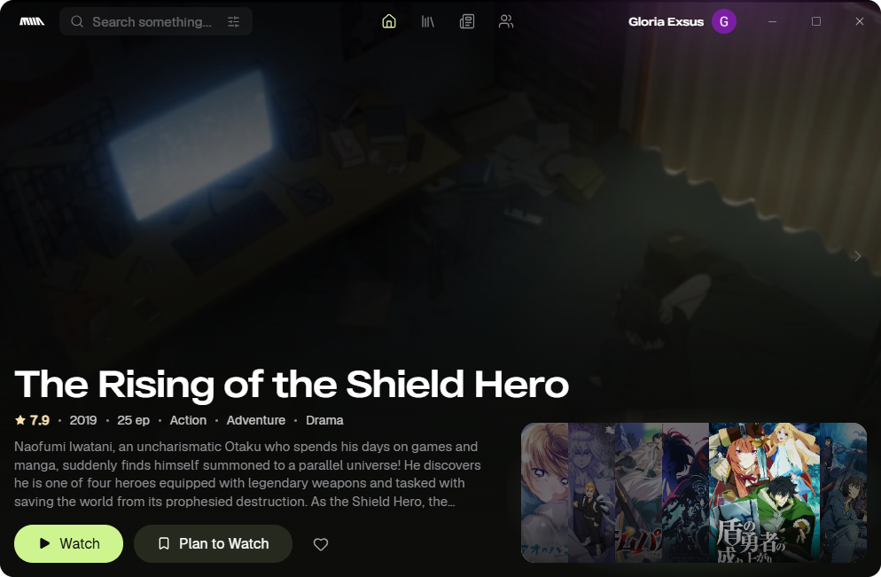
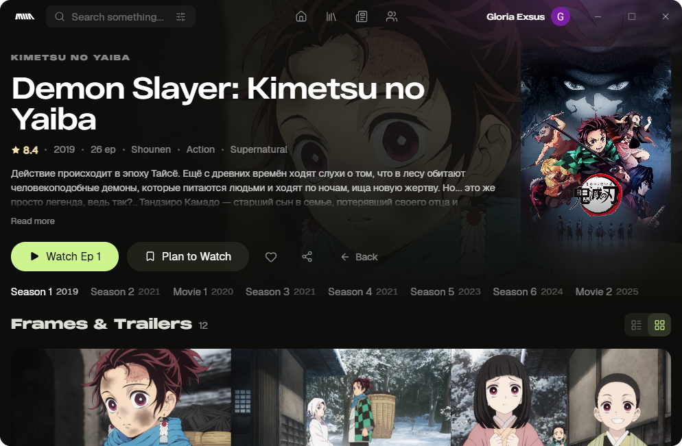
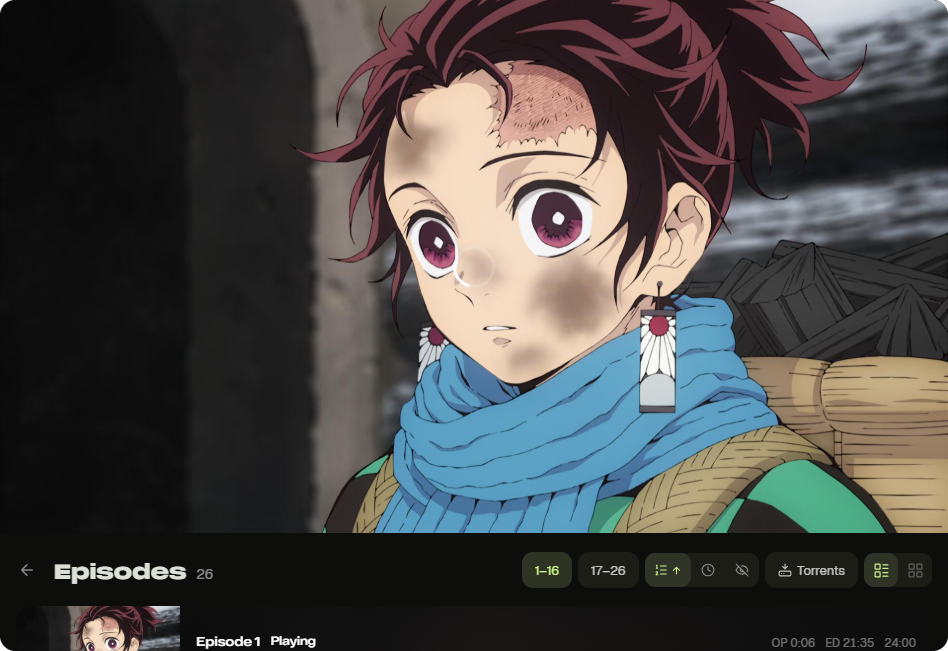
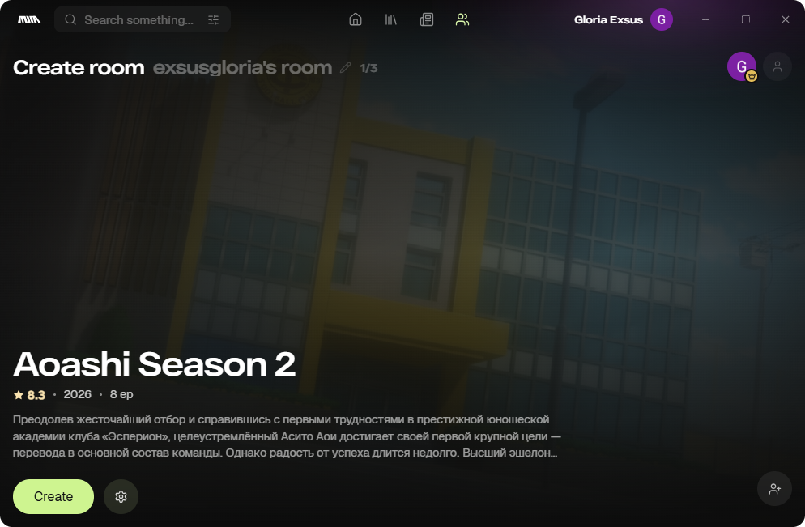
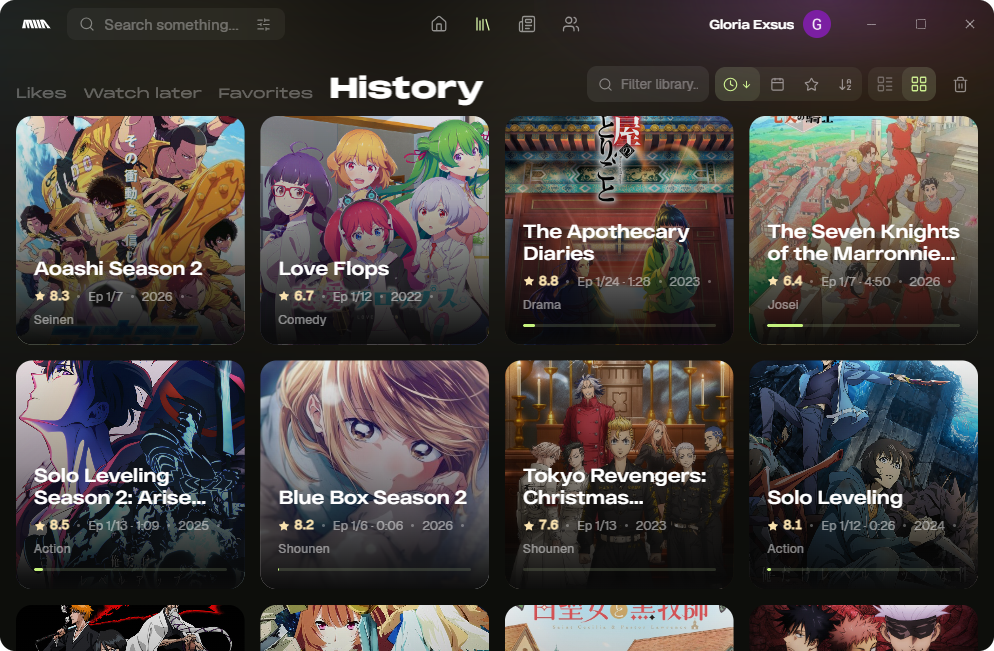
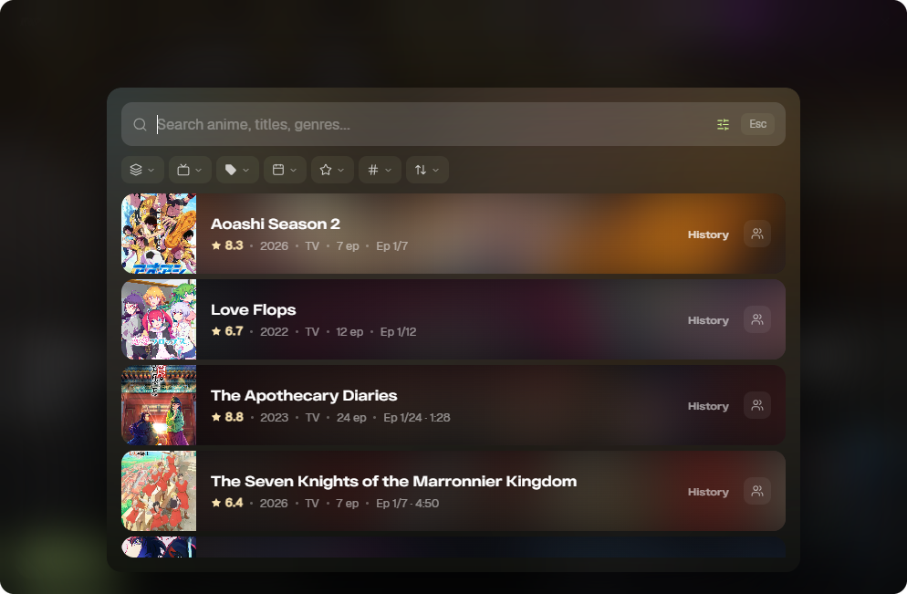
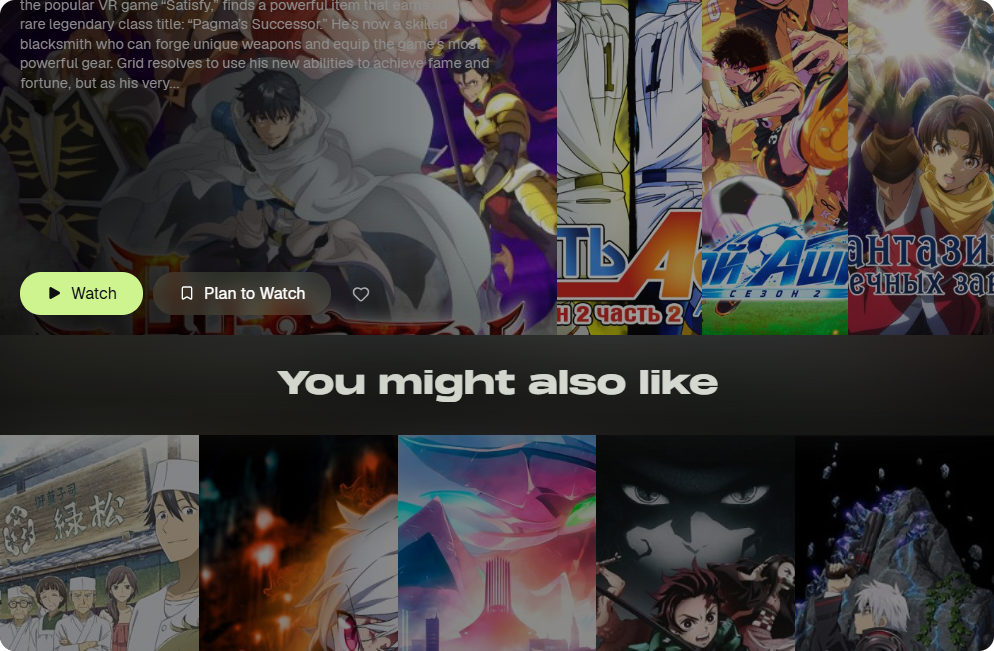

<div align="center">
  <br />
  <picture>
    <source media="(prefers-color-scheme: dark)" srcset=".github/assets/logo-dark.png" />
    <source media="(prefers-color-scheme: light)" srcset=".github/assets/logo-light.png" />
    
  </picture>
  <br /><br />
  <p>Native desktop anime client for Windows.</p>
  <p>
    <a href="https://github.com/mila-desktop/desktop/releases/latest">Download</a>
    &nbsp;·&nbsp;
    <a href="https://github.com/mila-desktop/desktop/releases">Releases</a>
    &nbsp;·&nbsp;
    <a href="https://github.com/mila-desktop/desktop/issues">Issues</a>
  </p>
  <br />
  
</div>

<br />

<table>
  <tr>
    <td width="50%" valign="top">
      
      <p align="center"><sub>Anime page, seasons &amp; frames</sub></p>
    </td>
    <td width="50%" valign="top">
      
      <p align="center"><sub>Adaptive HLS/MP4 &amp; torrent player</sub></p>
    </td>
  </tr>
  <tr>
    <td width="50%" valign="top">
      
      <p align="center"><sub>Watch Together rooms &amp; live sync</sub></p>
    </td>
    <td width="50%" valign="top">
      
      <p align="center"><sub>Library, likes &amp; watch history</sub></p>
    </td>
  </tr>
  <tr>
    <td width="50%" valign="top">
      
      <p align="center"><sub>Instant catalog search &amp; filters</sub></p>
    </td>
    <td width="50%" valign="top">
      
      <p align="center"><sub>Curated feeds &amp; recommendations</sub></p>
    </td>
  </tr>
</table>

<br />

### Architecture

Built with a **Go** host runtime ([Wails v2](https://wails.io/) + WebView2) and a custom **Svelte 5** interface (`marlakit`).

- **Playback** — Multi-source HLS/MP4 resolution with local Go stream proxying (`/ext/stream`), OP/ED skip markers, dual-audio voiceover mixing, and native Picture-in-Picture.
- **Torrents** — Built-in search across AniLibria, Nyaa, and Sukebei with direct streaming and live remuxing via `anacrolix/torrent`.
- **Watch Together** — Synchronized watch rooms with host/everyone playback control, friend presence, invites, and theater split-screen chat.
- **Sync & Themes** — Optional Google account sync for library and episode progress, localization (`en`, `ru`, `uk`, `zh`), and JSON-driven theme presets (`Dark`, `Light`, `Accent`).

### Development

```sh
# Install frontend dependencies
npm --prefix frontend install

# Start live development shell
wails dev

# Build production binary (build/bin/mila.exe)
wails build
```
