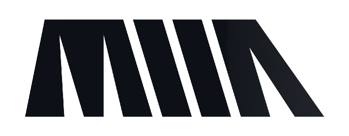
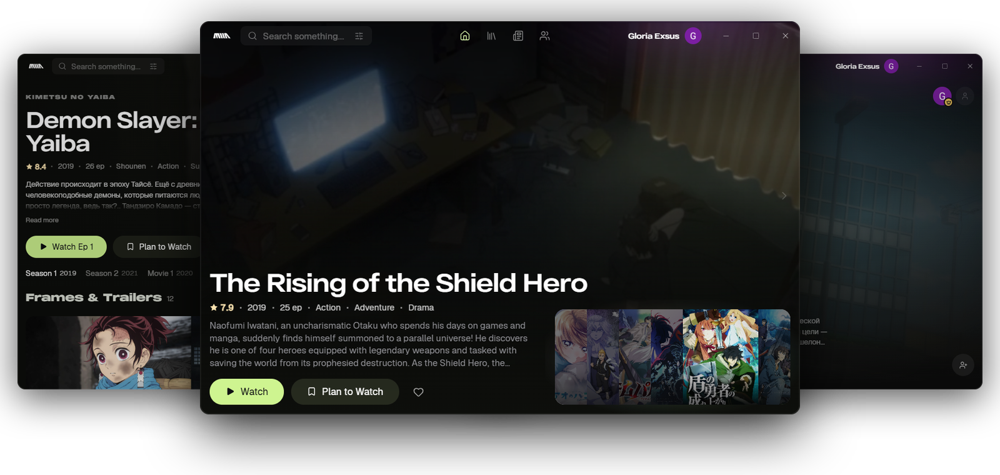
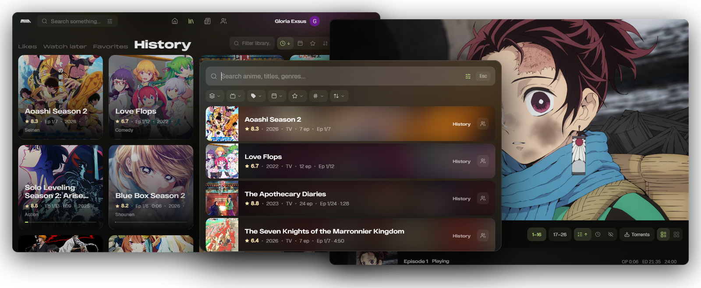

<div align="center">
  <br />
  <picture>
    <source media="(prefers-color-scheme: dark)" srcset=".github/assets/logo-dark.png" />
    <source media="(prefers-color-scheme: light)" srcset=".github/assets/logo-light.png" />
    
  </picture>
  <br /><br />
  <p>Native desktop anime client for Windows.</p>
  <p>
    <a href="https://github.com/mila-desktop/desktop/releases/latest">Download</a>
    &nbsp;·&nbsp;
    <a href="https://github.com/mila-desktop/desktop/releases">Releases</a>
    &nbsp;·&nbsp;
    <a href="https://github.com/mila-desktop/desktop/issues">Issues</a>
  </p>
  <br />
  
  
</div>

<br />

**Mila** pairs a native **Go** runtime ([Wails v2](https://wails.io/) + WebView2) with a custom **Svelte 5** interface (`marlakit`).

- **Streaming & Torrents** — Multi-source HLS/MP4 playback, local Go stream proxy (`/ext/stream`), dual-audio voiceover mixing, OP/ED skip markers, Picture-in-Picture, and built-in torrent streaming (`anacrolix/torrent`).
- **Watch Together** — Synchronized rooms with host/everyone playback control, friend presence, invites, and split-screen theater chat.
- **Library & Personalization** — Google cloud sync for likes, watch later, and episode progress, localization (`en`, `ru`, `uk`, `zh`), and JSON theme presets (`Dark`, `Light`, `Accent`).

```sh
npm --prefix frontend install
wails dev      # live development
wails build    # -> build/bin/mila.exe
```
