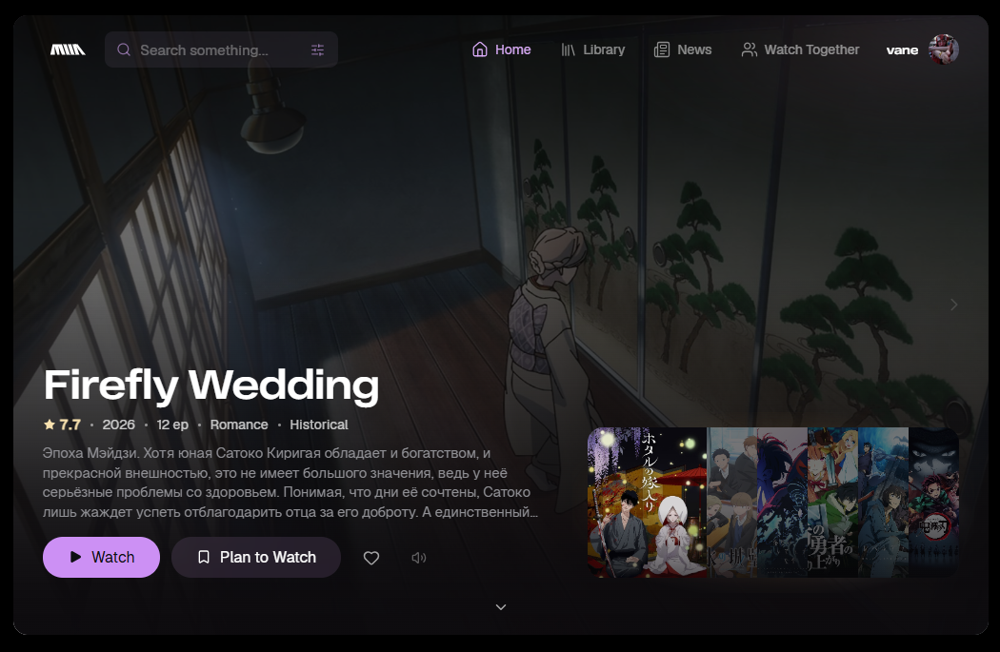
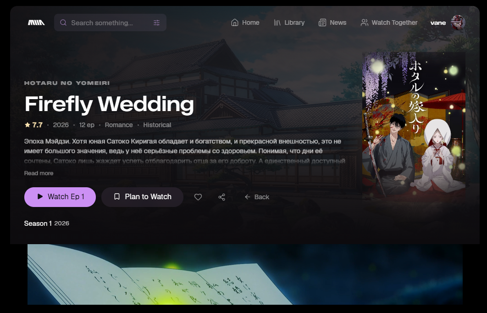
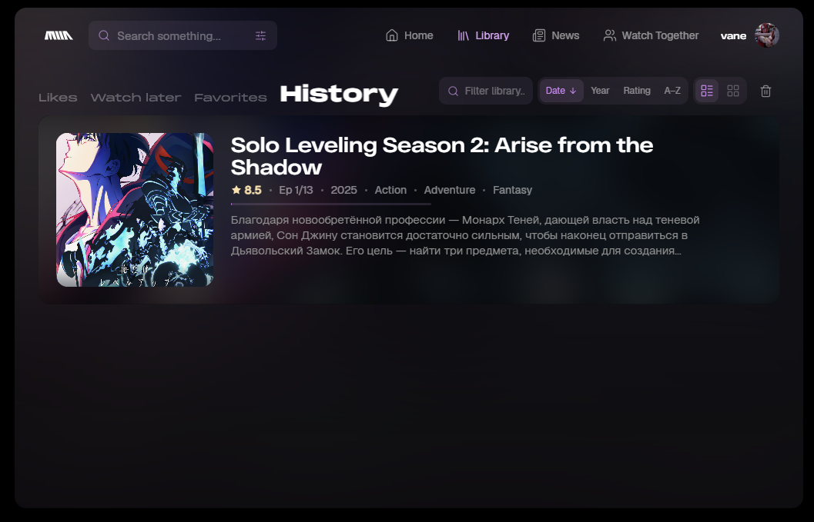
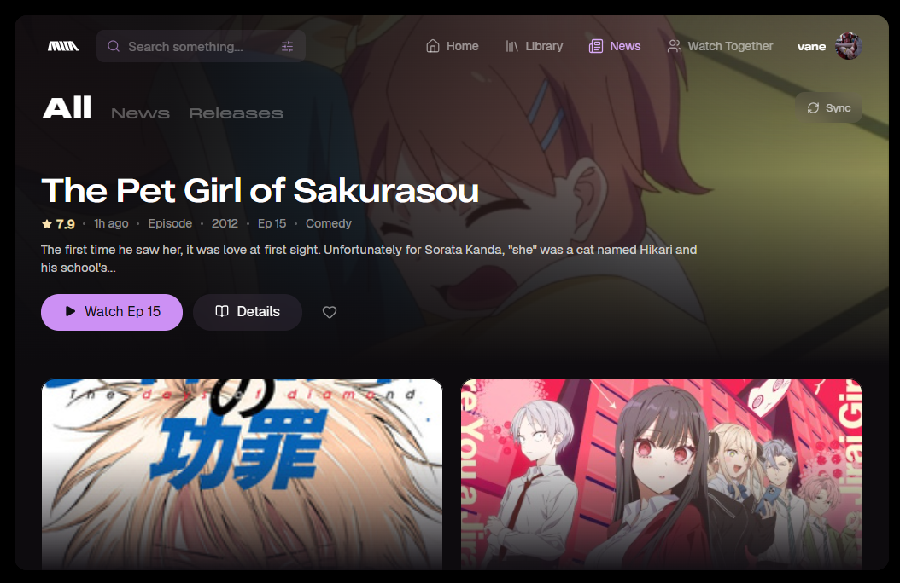

<div align="center">
  <br />
  <picture>
    <source media="(prefers-color-scheme: dark)" srcset=".github/assets/logo-dark.png" />
    <source media="(prefers-color-scheme: light)" srcset=".github/assets/logo-light.png" />
    
  </picture>
  <br /><br />
  <p><strong>Minimalist desktop anime client built with Go, Wails v2, and Svelte 5.</strong></p>
  <p>
    <a href="https://github.com/mila-desktop/desktop/actions/workflows/ci.yml"></a>
    
    
    
    
  </p>
</div>

---

## Preview

<table>
  <tr>
    <td width="50%" align="center">
      
      <br /><sub><b>Home Spotlight</b> — Opening preview, accent theme & panorama strip</sub>
    </td>
    <td width="50%" align="center">
      
      <br /><sub><b>Anime Page</b> — Multi-season overview, Likes, Plan to Watch & cast</sub>
    </td>
  </tr>
  <tr>
    <td width="50%" align="center">
      
      <br /><sub><b>Library &amp; History</b> — Likes, Watch Later, Favorites &amp; synced resume progress</sub>
    </td>
    <td width="50%" align="center">
      
      <br /><sub><b>News &amp; Releases</b> — Live episode updates and editorial feed</sub>
    </td>
  </tr>
</table>

## Overview

**Mila** is a native Windows desktop anime streaming application powered by a Go host backend (`Wails v2` + WebView2) and a custom `Svelte 5` interface (`marlakit`). It combines multi-provider adaptive HLS/MP4 playback, built-in torrent streaming, customizable themes, multi-language localization, and optional cloud profile sync.

## Features

- **Multi-Source Playback** — Unified resolution across Zoko (1080p English Dub), AniLibria, Dream Cast, AnimeGO, AnimeVost, Kodik, HentaiMama, and HentaiGasm with automatic fallback and audio/source switching.
- **Built-in Torrent Streaming** — Concurrent search across AniLibria, Nyaa, and Sukebei with direct streaming and on-the-fly remuxing via `anacrolix/torrent`.
- **Custom Player (`hls.js`)** — Adaptive bitrate switching, OP/ED skip markers, native OS Picture-in-Picture, and local Go stream/M3U8 proxy (`/ext/stream`).
- **Themes & Token System** — Built-in **Dark**, **Light** (adaptive black/white logo), and **Accent** presets backed by a unified JSON palette (`frontend/src/themes/themes.json`).
- **Localization (`i18n`)** — Interactive setup and instant switching across **English**, **Русский**, **中文**, and **Українська** with AniList/Shikimori metadata enrichment.
- **Cloud Profile & Library Sync** — Google OAuth sign-in syncing **Likes**, **Plan to Watch**, **Watch History**, and per-episode progress across sessions.

## Tech Stack

| Layer | Technology |
| --- | --- |
| Desktop Shell | [Wails v2](https://wails.io/) (`v2.17.1`), WebView2 |
| Frontend | [Svelte 5](https://svelte.dev/), TypeScript, Vite |
| Video & Streaming | `hls.js`, HTML5 MP4 Range, Go `/ext/stream` proxy |
| Backend & Cloud | Go `1.26`, `net/http`, TLS-pinned Cloud API client |
| Torrents | [`anacrolix/torrent`](https://github.com/anacrolix/torrent) (`v1.62.0`) |
| Tooling | `go test`, `svelte-check`, `vitest` |

## Getting Started

### Prerequisites

- **Go** `1.26+`
- **Node.js** `20+` and `npm`
- **Wails CLI** `v2` (`go install github.com/wailsapp/wails/v2/cmd/wails@latest`)
- **WebView2 Runtime** (Windows)

### Install & Run

```sh
# Install frontend dependencies
npm --prefix frontend install

# Run in development mode (hot reload)
wails dev
```

### Production Build

```sh
wails build
```

The compiled executable is written to `build/bin/mila.exe`.

### Tests & Checks

```sh
# Backend unit tests
go test -count=1 ./internal/...

# Frontend typecheck & unit tests
npm --prefix frontend run check
npm --prefix frontend test
```

## Project Structure

```text
.
├── main.go                 # Wails entry point and window lifecycle
├── wails.json              # Wails project configuration
├── images/                 # Showcase screenshots
├── internal/
│   ├── mila/               # App bindings, stream proxy, provider extractors
│   ├── torrent/            # Nyaa/Sukebei/AniLibria search & torrent streaming
│   ├── cloud/              # OAuth & cloud API client
│   ├── shikimori/          # Catalog & metadata integration
│   └── cache/              # L1/L2 caching layer
├── frontend/
│   ├── src/
│   │   ├── api/            # Providers, unified bridge & cloud API
│   │   ├── app/            # Auth, cloud sync, i18n, themes & state controllers
│   │   ├── i18n/           # JSON locale dictionaries (en, ru, zh, uk)
│   │   ├── themes/         # Unified JSON theme tokens & adaptive SVG logo
│   │   ├── marlakit/       # Reusable UI kit & HLS player
│   │   └── pages/          # Home, Anime, Library, News, Watch Together
│   └── tests/              # Vitest test suite
└── build/                  # Platform icons, manifests & installer assets
```
